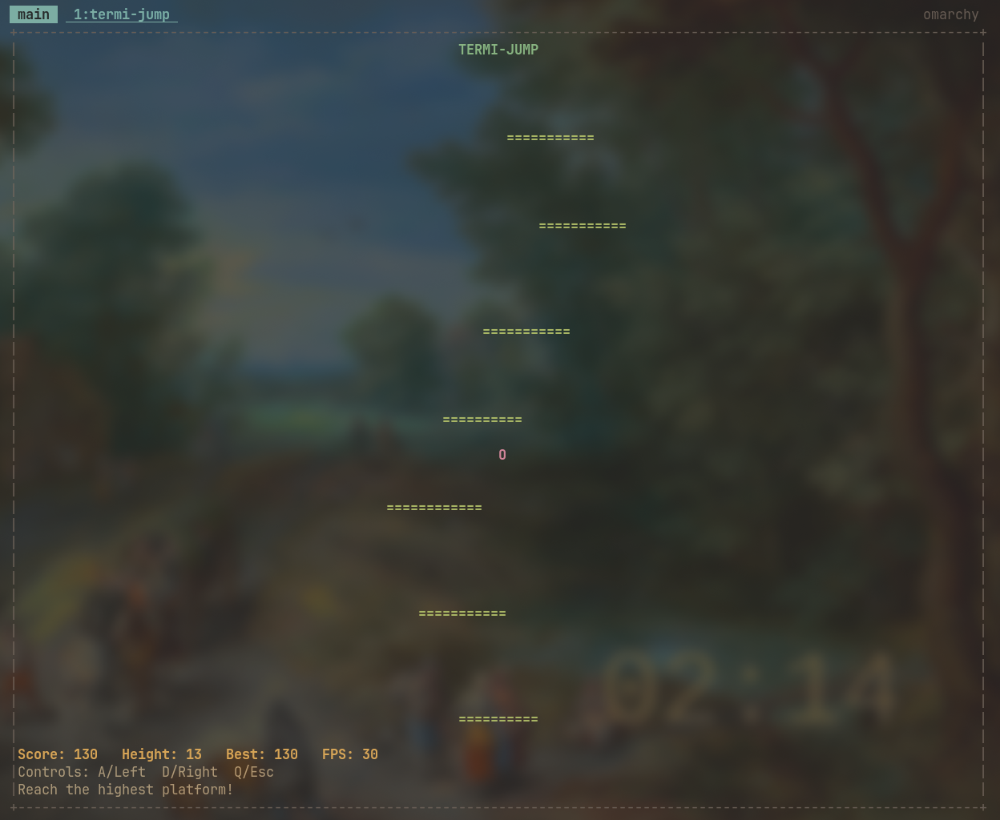

# Termi-Jump

Termi-Jump is a small platform-jumping game that runs inside a terminal. It is
written in Java. Guide the player between platforms and climb as high as you
can. The player jumps automatically after landing, so your job is to move left
or right and line up with the next platform.


*A game in progress: the player is the pink `O`, platforms are shown as `=`,
and the status area displays the score, height, best score, and frame rate.*

## Table of contents

- [How to play](#how-to-play)
- [Requirements](#requirements)
- [Install and run](#install-and-run)
- [Build and test](#build-and-test)
- [How the game works](#how-the-game-works)
- [Project structure](#project-structure)
- [Source files explained](#source-files-explained)
- [Tools and dependencies](#tools-and-dependencies)
- [Screenshots](#screenshots)

## How to play

| Key | Action |
|---|---|
| `A` or `←` | Move left |
| `D` or `→` | Move right |
| `R` | Start a new run after game over |
| `Q` or `Esc` | Quit |

The player starts above the first platform and jumps automatically. While the
player is in the air, steer toward another platform. The camera follows the
player upward. If the player falls far enough below the camera, the run ends.

The status area shows:

- **Score** — 10 points for each whole unit of the highest height reached in
  the current run.
- **Height** — the highest height reached, measured from the starting height.
- **Best** — the highest score reached since this program was started.
- **FPS** — the renderer's measured frames per second.

Your current score and height reset when you start a new run. Your best score
survives restarts, but it is kept only in memory: it is not saved to a file and
is lost when you close the program.

## Requirements

- Java 17 or newer.
- Maven 3.9 or newer.
- A terminal that accepts interactive keyboard input.

The project targets Java 17 bytecode, so a newer Java runtime can run it too.
Maven downloads the libraries needed to build and test the project. The
packaged application JAR includes its runtime dependencies.

## Install and run

Clone the repository and enter its directory:

```bash
git clone https://github.com/bahruzmammad/termi-jump.git
cd termi-jump
```

On Linux or macOS, build and start the game with:

```bash
./run.sh
```

On Windows, use:

```bat
run.bat
```

These scripts build the application and then launch `target/termijump.jar`.
You can also launch an already-built JAR directly:

```bash
java -jar target/termijump.jar
```

On Windows, the path separator is a backslash:

```bat
java -jar target\termijump.jar
```

## Build and test

Build the runnable JAR without running tests:

```bash
./build.sh       # Linux or macOS
build.bat        # Windows
```

Run the automated tests:

```bash
./test.sh        # Linux or macOS
test.bat         # Windows
```

The same tasks are available through Maven:

```bash
mvn test         # Compile and run tests
mvn package      # Run the test phase and package the application
```

The `build` scripts use Maven's `-DskipTests` option, so use the test command
separately when you want to check the code before packaging.

## How the game works

The game is split into a few small parts. Each part has one main job:

```text
Keyboard ──> InputHandler ──> Game ──> Player and PlatformGenerator
                                  │
                                  ├──> ScoreTracker
                                  └──> TerminalRenderer ──> Terminal
```

1. `Main` creates the terminal, keyboard input handler, and renderer.
2. `Game.run()` repeats the game loop about 30 times per second. Each loop
   checks input, updates the game, and draws a new frame.
3. `Player` applies horizontal movement and vertical physics. Gravity pulls
   the player down; landing on a platform starts another jump.
4. `PlatformGenerator` creates platforms ahead of the player and removes old
   platforms far below the camera. Platforms become gradually narrower and
   farther apart as the player climbs.
5. `ScoreTracker` records the highest point reached in the current run and
   keeps the best score across restarts.
6. `TerminalRenderer` converts the game world into terminal rows and columns,
   then draws the player, platforms, and status text.

The game uses a fixed target frame interval and measures elapsed time for
physics updates. A long pause is capped so returning to the game does not
cause the player to jump or fall an unexpectedly large distance in one update.
The renderer checks terminal size periodically and keeps its drawing buffers
within supported minimum and maximum dimensions.

### Coordinates, movement, and difficulty

The game world uses `x` for horizontal position and `y` for height. Increasing
`x` moves right; increasing `y` moves up. The terminal screen works the other
way vertically (row numbers increase downward), so the renderer converts world
heights into screen rows when drawing.

The main physics values are in `Player.java`:

- Horizontal movement speed is **13 world units per second**.
- Gravity is **34 world units per second squared**.
- A new jump starts with an upward speed of **24 world units per second**.
- The player is kept inside the horizontal world edges.
- A landing is detected when a falling player crosses a platform's height
  between two updates and is horizontally over that platform. Checking the
  crossing prevents a fast fall from skipping a platform between frames.

The game loop targets **30 updates per second** and caps one physics update to
**0.05 seconds** after a pause. Keyboard terminals often report individual key
presses rather than a key being continuously held; `InputHandler` therefore
keeps left/right movement active briefly after each key press.

`PlatformGenerator.java` increases difficulty gradually over the first **300
world-height units**. As that difficulty rises, platforms become narrower and
the vertical gaps get larger. Platform positions and sizes include random
variation, so a new run does not normally use the same layout. The generator
accepts a seeded random number source in tests to make a test layout repeatable.

The displayed height is the greatest player height above the starting height,
rounded down to a whole unit. The score is that height multiplied by **10**.
The camera starts moving up when the player passes about **65%** of the
playable screen height. A run ends when the player falls more than **2 world
units** below the camera; platforms more than **5 units** below it can be
discarded.

## Project structure

```text
.
├── imgs/
│   ├── gameplay.png
│   └── gameplay-score-130.png
├── src/
│   ├── main/
│   │   ├── java/com/termijump/
│   │   └── resources/META-INF/jline/providers/jni
│   └── test/java/com/termijump/
├── .gitignore
├── .mise.toml
├── build.bat
├── build.sh
├── pom.xml
├── README.md
├── run.bat
├── run.sh
├── test.bat
└── test.sh
```

`src/main/java` contains the game code. `src/test/java` contains automated
tests. `imgs` contains the screenshots embedded in this document. Maven writes
generated classes and the packaged JAR under `target/`; those build outputs
are not source files.

### Generated files in `target/`

`target/` is created and updated by Maven. It is ignored by Git and can be
recreated by running the build or test commands. Do not edit these files by
hand: Maven may replace them, and compiled files are not the source of the
program.

| Generated path | Meaning |
|---|---|
| `target/classes/com/termijump/*.class` | Compiled Java bytecode for the application. These binary files are produced from `src/main/java`. |
| `target/test-classes/com/termijump/*.class` | Compiled test bytecode produced from `src/test/java`. |
| `target/classes/META-INF/jline/providers/jni` | Copy of the JLine provider descriptor from `src/main/resources`. It contains a provider class name in a format JLine reads; adding prose or comments could stop provider discovery. |
| `target/maven-status/maven-compiler-plugin/.../*.lst` | Maven compiler bookkeeping: lists of source files compiled and class files created. Maven regenerates these lists. |
| `target/maven-archiver/pom.properties` | Generated project coordinates and version metadata used when packaging the application. |
| `target/termijump.jar` | Runnable application archive containing compiled classes and runtime dependencies. It is a binary archive, not an editable source file. |
| `target/original-termijump.jar` | Pre-shading archive retained by the Maven Shade Plugin while it creates the runnable JAR. |
| `target/surefire-reports/TEST-com.termijump.GameTest.xml` | Machine-readable JUnit results generated by Maven Surefire. |
| `target/surefire-reports/com.termijump.GameTest.txt` | Human-readable summary of the same test run. |

Comments belong in editable source and configuration files. Java comments
explain class responsibilities, method behavior, and decisions that are not
obvious from the code. Shell and batch comments explain the commands and
platform-specific syntax. XML comments describe the purpose of Maven settings.
Comments are kept in English and avoid repeating every simple statement.

Binary images, `.class` files, and `.jar` archives cannot use ordinary source
comments. The screenshots in `imgs/` are documented by their captions here;
generated binaries and reports are described above. The provider descriptor
must remain in its format expected by JLine.

## Source files explained

### Application code

| File | What it does |
|---|---|
| `Main.java` | The program's entry point. It opens the JLine terminal, creates the input handler and renderer, and starts the game. It uses `try`-with-resources so terminal resources are closed when the game exits. If terminal setup or input/output fails, it prints an error and exits with a failure status. |
| `Game.java` | Coordinates the game. Its loop checks for quit/restart input, updates the player and score, moves the camera, asks for more platforms, removes platforms that are no longer needed, and tells the renderer to draw. It also decides when the player has fallen far enough for the run to end. |
| `GameState.java` | Names the three possible game states: `PLAYING`, `GAME_OVER`, and `QUIT`. Using named states makes the game flow easier to read than using unexplained numbers or strings. |
| `Player.java` | Stores the player's world position and vertical velocity. It applies left/right movement, gravity, and jumping; keeps the player inside the horizontal world bounds; and detects when a falling player crosses a platform. Landing sets the player on the platform and starts the next jump. |
| `Platform.java` | Describes one platform with an `x` position, a `y` height, and a width. It rejects invalid values and provides a check for whether the player's horizontal position overlaps the platform's landing area. |
| `PlatformGenerator.java` | Creates the starting platform and generates more platforms up to a requested height. It gradually adjusts platform width and vertical spacing to increase difficulty, keeps platforms inside the world, and discards platforms below the retained area. Its `Random` can be supplied by tests so generated layouts are repeatable. |
| `InputHandler.java` | Reads keyboard bytes from JLine on a background thread. It translates `A`/`D` and arrow keys into movement, `R` into a restart request, and `Q`/`Esc` into a quit request. It enters raw terminal mode to read keys promptly and restores the terminal's original settings when closed. |
| `InputSource.java` | The small interface `Game` uses to ask whether a direction is pressed or whether quit/restart was requested. This keeps game logic independent from JLine and lets tests provide fake input without a real keyboard. |
| `TerminalRenderer.java` | Draws the game in the terminal. It maps world coordinates to screen rows and columns, renders platforms/player/status text, and measures FPS. When ANSI is supported, it uses colors and cursor positioning to update the screen in place; otherwise, it prints plain-text frames. It also restores the display when closed. |
| `ScoreTracker.java` | Tracks the maximum height reached in a run, calculates the current score from that height, and preserves the best score when a run is reset. |

### Tests, resources, and project configuration

| File | What it is for |
|---|---|
| `GameTest.java` | JUnit tests for movement, gravity, landing, score tracking, platform generation, camera movement, game over/restart/quit, and terminal rendering. A fake input source and seeded random generators make game behavior testable without playing manually. |
| `src/main/resources/META-INF/jline/providers/jni` | JLine provider metadata included in the application resources so JLine can locate its JNI terminal provider. |
| `pom.xml` | Maven project configuration. It sets the project name/version and Java release, declares JLine and test-only JUnit dependencies, enables compiler warnings, configures the test runner, and uses the Shade Plugin to create `target/termijump.jar` with `com.termijump.Main` as its entry point. |
| `.mise.toml` | Selects a Java distribution/version for developers using `mise`. The Maven compiler target remains Java 17, as configured in `pom.xml`. |
| `.gitignore` | Keeps generated build output, IDE files, logs, temporary files, and local secret/config files out of Git. |
| `build.sh` / `build.bat` | Run Maven packaging without tests and report the path of the resulting JAR. The shell script is for Linux/macOS; the batch file is for Windows. |
| `run.sh` / `run.bat` | Build the application and then start the packaged JAR. |
| `test.sh` / `test.bat` | Run the Maven test phase on Linux/macOS or Windows. |
| `README.md` | This guide: setup, gameplay, architecture, and file descriptions. |

## Tools and dependencies

- **Java 17** — language and minimum bytecode target.
- **Maven** — dependency management, compilation, tests, and packaging.
- **JLine 3** — terminal input, terminal sizing, and ANSI-related terminal
  support.
- **JUnit 5** — automated tests.
- **Maven Shade Plugin** — combines the application and runtime dependencies
  into a runnable JAR.

The JAR's main class is `com.termijump.Main`. ANSI colors are disabled when
`NO_COLOR` is set or the terminal reports its type as `dumb`. A terminal still
needs to support interactive keyboard input for gameplay.

## Screenshots


*Gameplay view with a score of 290 and a height of 29.*



*A second gameplay view showing a score of 130 and a height of 13.*
